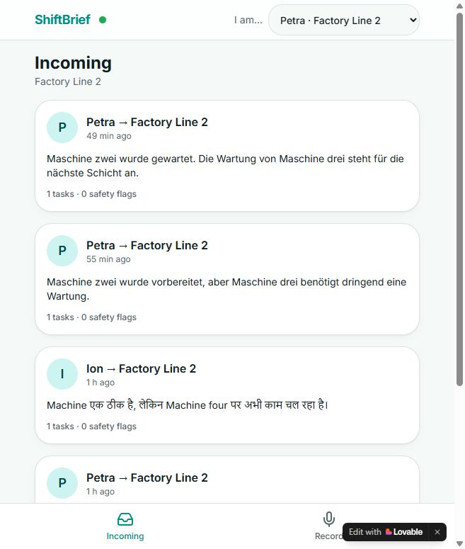
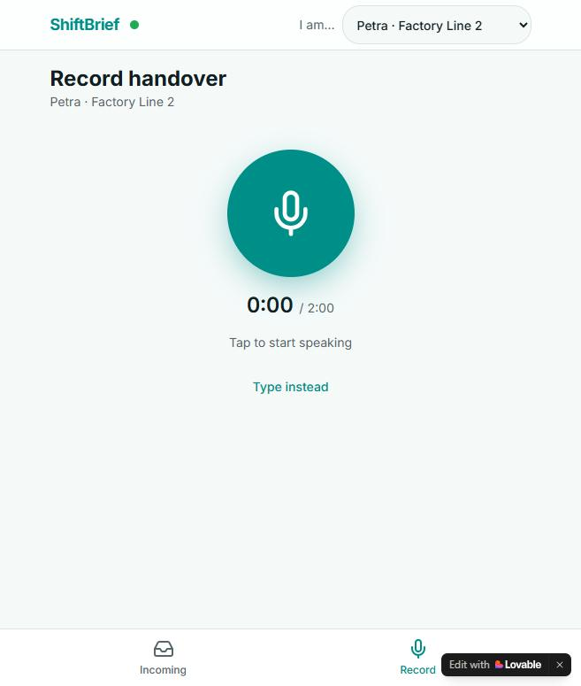
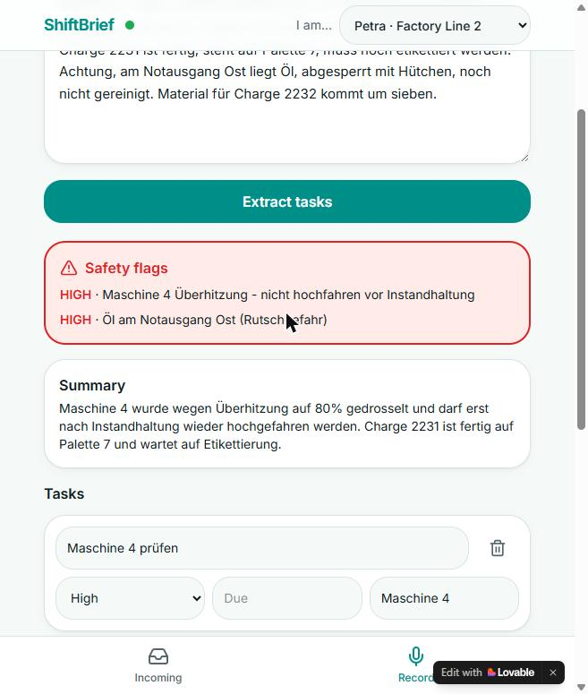
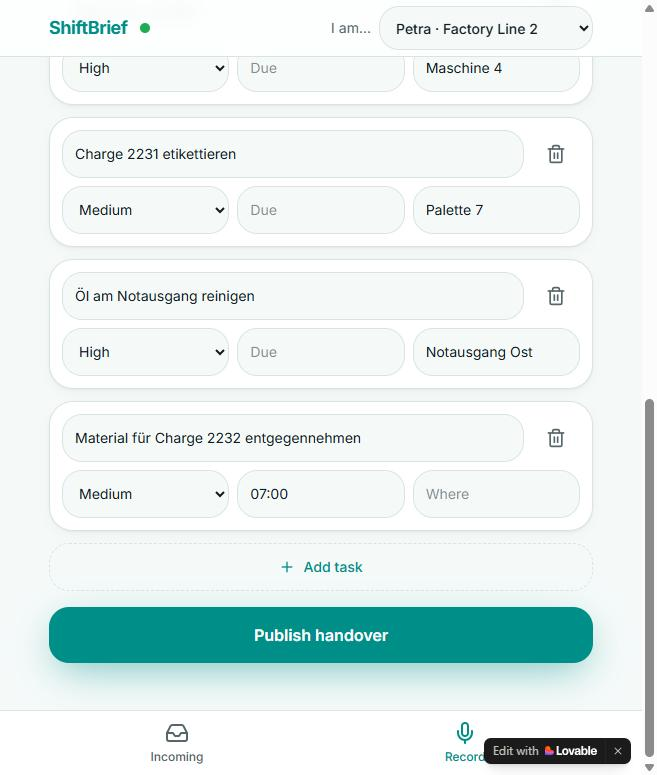
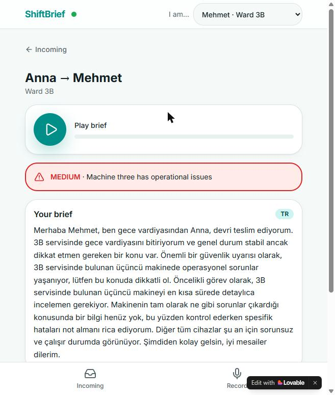
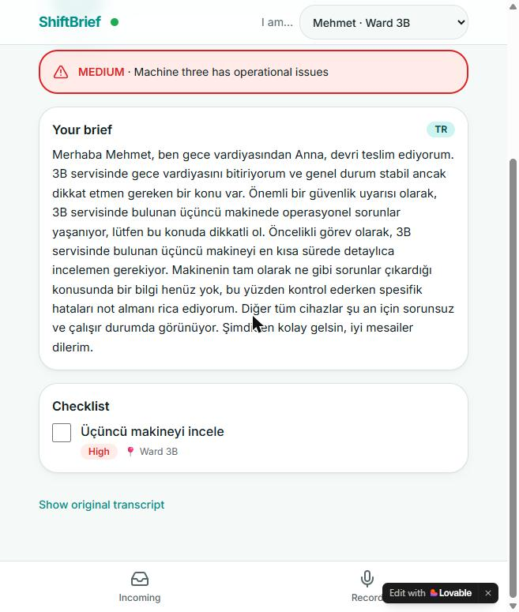

# ShiftBrief – Voice Shift Handover

**Live app:** https://shiftbrief.lovable.app
**Demo video (2 min):** [ShiftBrief.mp4](https://github.com/hansczylok/ShiftBrief/blob/main/ShiftBrief.mp4)

A worker ending a shift dictates the handover. The next worker hears a 60-second personalized
audio brief in their own language and gets a tappable checklist. Works for hospital wards,
hotel front desks, factory lines and on-call rotations.

Built in one afternoon at the **Hacktoberfest Hack Day Linz × Young AI Leaders Linz**
(30 October 2026, JKU Linz).

## How it works

1. **Dictate.** The outgoing worker taps the mic and speaks for 20 to 60 seconds.
2. **Transcribe.** ElevenLabs Scribe turns the recording into text.
3. **Understand.** Gemma 4 extracts tasks with priority, time and location, flags anything
   safety-relevant (fall risk, fasting patient, faulty machine, blocked exit), and writes a summary.
   The worker reviews and edits the list, then publishes it to their team.
4. **Brief.** When the incoming worker opens the handover, Gemma 4 writes a spoken script in that
   worker's language, personalized with both names and roles. ElevenLabs reads it aloud. The
   translated checklist persists ticks per person.

German in, Turkish or English out, with room numbers, names and ticket numbers kept intact.

## Screenshots

| Incoming handovers | Record a handover | Extracted safety flags |
|---|---|---|
|  |  |  |

| Editable task list | Brief in Turkish (dictated in German) | Translated checklist |
|---|---|---|
|  |  |  |

## Stack

| Part | Technology |
|---|---|
| App, database, server routes | [Lovable](https://lovable.dev) with Lovable Cloud (Postgres + server functions) |
| Speech-to-text | ElevenLabs Scribe (`scribe_v1`) |
| Text-to-speech | ElevenLabs Multilingual v2 |
| Reasoning, extraction, translation | **Gemma 4** (`gemma-4-26b-a4b-it`, open weights) via the Gemini API |

Gemma 4 is the core of the product: every task, safety flag, translation and spoken script comes
from it. Because the weights are open, the same prompts can run on-prem.

## AI tools used (disclosure)

| Tool | What it did |
|---|---|
| **Lovable** (AI app builder) | Generated the entire application from our written specification: React UI, Postgres schema, server routes, tests. We iterated with follow-up prompts. |
| **Claude Code** (Anthropic, model Claude Fable 5.1) | Wrote `SPEC.md` and this README from our idea, sent the prompts to Lovable, debugged the empty-transcript problem, and handled git. |
| **Gemma 4** (`gemma-4-26b-a4b-it`, open weights, Gemini API) | Runtime model inside the product: task extraction, safety flags, translation, brief script. |
| **ElevenLabs Scribe v1** and **Multilingual v2** | Runtime speech-to-text and text-to-speech inside the product. |

No image generators were used.

## Work timeline (disclosure)

- **Built during the event (30 Oct 2026, from 14:00):** the idea decision, `SPEC.md`, the entire
  ShiftBrief application in Lovable (every screen, table, server route and prompt), testing and
  this README. The Lovable project was created at 14:27.
- **Before the event (28–30 Oct, before 14:00):** the Python folder `app/` in this repository.
  It is a small FastAPI warm-up we wrote while setting up accounts and API keys, to confirm that
  Gemma 4 and ElevenLabs calls work from a laptop. **It is not part of the submitted product and
  the live app does not use it.** We keep it in the repo because it shows how the same Gemma 4
  prompts can run against a self-hosted Vertex AI endpoint instead of the Gemini API.

## What we learned

- Lovable Cloud can host server-side code as app routes, so we dropped the planned Python
  backend and the tunnel entirely. One project, one owner, no moving URL.
- Gemma 4 on the Gemini API has no structured-output mode. Asking for JSON in the prompt and
  parsing from the first `{` to the last `}` with one retry was enough.
- ElevenLabs Scribe handles German dictation with room numbers and ticket numbers well, and
  one Multilingual v2 voice covers German, Turkish and English output.
- The hardest bug was not AI at all: Chrome had blocked the microphone for the site, so every
  recording was silent and the transcript came back empty. We now show the recorded audio size in
  the error toast so this is visible immediately.

## What is in this repository

| Path | Purpose |
|---|---|
| `lovable-app/` | **The application source** exported from the Lovable project: TanStack Start + React 19 + Tailwind, Drizzle migration for the four tables, the five server routes under `src/routes/api/public/`, Gemma 4 prompts in `src/server/prompts.ts`, Gemini call with fallbacks in `src/server/ai.ts`. Secrets are not included; the routes read them from the environment. |
| `docs/screenshots/` | Screenshots of the live app |
| `ShiftBrief.mp4` | 2-minute demo recording |
| `SPEC.md` | Full product specification: scope, personas, demo data, architecture, API contracts, Lovable prompt, Gemma prompts, risks |
| `app/` | Pre-event warm-up backend (see timeline above): `/analyze` (Gemma 4, text + image), `/speak` (ElevenLabs TTS), Vertex AI switch |
| `Dockerfile`, `docker-compose.yml` | Run the warm-up backend in a container |

The application is developed in the Lovable project and deployed at the link above; `lovable-app/`
is a snapshot of its source exported after the last change on 30 Oct 2026.

## Team

- **Hans Czylok** – [@hansczylok](https://github.com/hansczylok)
- **Rohit Kadam**
- **Peter Paul Kirschner** – [@petkir](https://github.com/petkir)
- **Syed Alhaam Faridi**

## Running the warm-up backend (optional, not part of the product)

```bash
python -m venv .venv
.venv\Scripts\activate            # Windows (PowerShell: .venv\Scripts\Activate.ps1)
pip install -r requirements.txt
copy .env.example .env            # then fill in the keys
uvicorn app.main:app --reload
```

Test page: http://localhost:8000 · API docs: http://localhost:8000/docs

With Docker: `docker compose up --build`

### Choosing where Gemma 4 runs

`GEMMA_BACKEND` in `.env` selects the backend:

| Value | Where | Needs |
|---|---|---|
| `gemini` (default) | Gemini API | `GEMMA_API_KEY`, `GEMMA_MODEL` |
| `vertex` | your own Vertex AI endpoint (Model Garden, vLLM) | `VERTEX_ENDPOINT_URL`, `gcloud auth application-default login` |

The endpoint URL is built from `gcloud ai endpoints list --region=<REGION> --format="table(name.basename(),dedicatedEndpointDns)"`
and your project number (format in `.env.example`). A Vertex endpoint costs money while a model is
deployed; undeploy after the demo with `gcloud ai endpoints undeploy-model …`. `GEMMA_THINKING`
applies to `gemini` only. Inside Docker there is no gcloud login, so `vertex` needs a service-account
key via `GOOGLE_APPLICATION_CREDENTIALS`.

### Endpoints

| Method | Path | Input | Output |
|---|---|---|---|
| GET | `/health` | – | which keys are set |
| POST | `/analyze` | multipart: `prompt` (text), `image` (optional) | `{"answer": "..."}` |
| POST | `/speak` | JSON: `{"text": "..."}` | `audio/mpeg` |

## License

MIT
